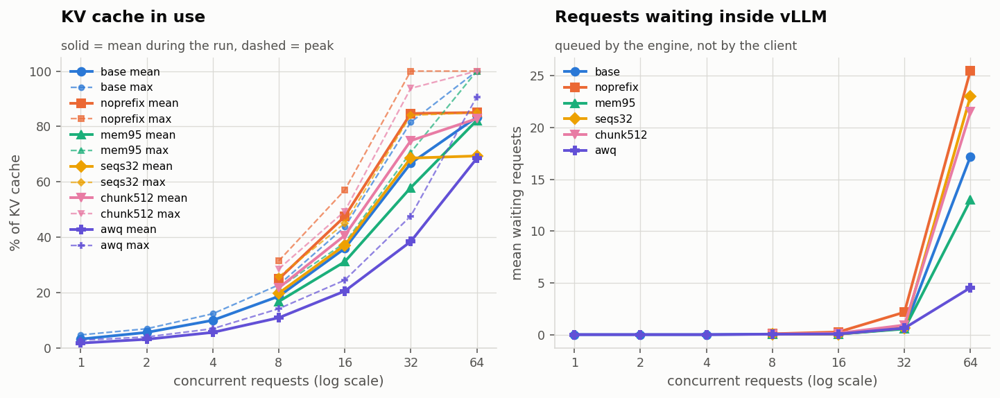

# Vantage

**A serving-performance and answer-quality benchmark harness for LLM inference.**

Most "I deployed an LLM" projects stop at a working endpoint. Vantage is the
part that comes after: it drives real load at a serving stack, measures what it
actually does under that load, prices it, checks that the optimisations did not
quietly make the answers worse, and writes the whole thing up.

```bash
pip install -e . && vantage demo        # no GPU, no API key, ~2 minutes
```

That produces a run directory with per-request records, per-configuration
summaries, six charts and a written report with its own caveats section.

---

## What it measures, and why those things

| | |
|---|---|
| **TTFT, ITL, end-to-end, total** | Four different latencies that benchmarks routinely conflate. `total` is measured from request *arrival*, so queueing is inside it — the number a user experiences. |
| **Closed-loop and open-loop load** | Closed loop answers "how does it behave at concurrency N". Open loop (Poisson arrivals) answers "what happens at N requests per second" — and is the only mode that can show the saturation cliff, because a closed-loop client throttles itself whenever the server slows down. |
| **Goodput, not just throughput** | Requests per second that *met the SLO*. A config that doubles throughput while blowing the SLO on 40% of requests has not doubled anything. |
| **Cost per 1,000 requests, and break-even** | API cost scales with tokens; self-hosting costs the same whether the GPU is busy or idle. Those two lines cross somewhere, and finding where is the actual engineering question behind "should we self-host". |
| **Answer quality, as a gate** | Every optimisation here trades quality for speed somewhere. Token F1, citation grounding and number agreement run on a held-out set, compared by paired bootstrap, and a config that regresses beyond budget is marked FAIL no matter how fast it is. |

## What it can point at

One adapter covers every OpenAI-compatible server, which is nearly all of them:
**vLLM**, **SGLang**, **TGI**, **llama.cpp**, **Ollama**, **LM Studio**, the
**OpenAI API** and most hosted providers. Plus a **simulated backend** that
models a continuous-batching engine, so the entire harness — including CI —
runs with no GPU at all.

## The optimisations it implements and measures

- **Semantic caching** — embedding-similarity lookup with a tunable threshold,
  shipped with the analysis that chooses the threshold (below).
- **Prefix caching**, **quantisation** (fp16 / int8 / int4) and
  **batching/concurrency** — configured, swept and compared.
- **Server settings, one at a time** — a sweep can start and stop vLLM itself
  with different flags, and every run records what the server reported on
  `/metrics` (KV-cache use, queue, preemptions, prefix-cache hits), so a
  latency knee comes with its cause.
- **A fine-tuned small model** — `finetune/` distils a teacher, QLoRA-trains a
  4B student, and runs it through this same harness so it lands in the same
  table as everything else. See [finetune/README.md](finetune/README.md).

---

## The chart the project is really about

A semantic cache that returns a confident answer to a question nobody asked is
worse than no cache. So the threshold is chosen with the false-hit rate on
screen, not by picking 0.9 because it sounds safe:

| threshold | hit rate | false-hit rate |
|---|---|---|
| 0.70 | 80.0% | 6.6% |
| **0.80** | **76.1%** | **1.3%** |
| 0.90 | 70.2% | 0.0% |
| 0.96 | 63.6% | 0.0% |

Measured on Vectora's 365 real questions (all-MiniLM-L6-v2 embeddings), with a
query log that revisits each question five times, 60% of the time paraphrased:
the repeats are simulated, the questions are not. A false hit is a cache hit
whose served answer scores below 0.75 F1 against the *new* question's
reference. The sweep replays an ordered log through a cold cache at each
threshold; order matters, because a shuffled log overstates what a cold cache
can do. The recommended threshold (highest hit rate with at most 2% false
hits) is 0.80, which would avoid 1,388 of 1,825 model calls.

## Results on real hardware: Qwen3-4B on vLLM, Kaggle 2x T4

Qwen3-4B-Instruct-2507 served by vLLM 0.32.0, fp16 on one T4 and AWQ int4 on
the other, driven by Vectora's real workload: 365 prompts exactly as Vectora
sends them (about 1,030 prompt tokens and 145 answer tokens each). SLO: time to
first token p95 ≤ 2 s and total p95 ≤ 15 s. Two runs, 27 October 2026; full
numbers, server metrics and caveats in
[results/kaggle-t4-tuning-v3_2026-10-27](results/kaggle-t4-tuning-v3_2026-10-27/RUN.md)
and [results/kaggle-t4-baseline-v3_2026-10-27](results/kaggle-t4-baseline-v3_2026-10-27/RUN.md).

| | fp16 | AWQ int4 |
|---|---|---|
| time per token, one user | 43 ms | **19 ms** |
| highest concurrency inside the SLO | 4 | 4 |
| requests inside the SLO at 8 users | 47% | **76%** |
| peak throughput | 103 tok/s | **119 tok/s** |
| at 64 users: running / waiting / preempted | 45 / 17 / 19 | 64 / 4.5 / 0 |
| answer quality (gate, 32 references) | baseline | no regression detectable: −0.012, 95% CI [−0.033, +0.010] |
| $ per 1,000 answers inside the SLO ($0.35/h assumed) | $0.253 | **$0.172** |


What the measurements say:

- **On a T4 this model is compute-bound, and the server metrics show it.**
  fp16 breaks the SLO at 8 users with its KV cache under a quarter full and
  nothing waiting inside vLLM; what grows is the cost of each decode step (43 →
  301 ms per token from 1 to 32 users). Memory only becomes the limit at 64,
  where the cache fills and requests are preempted.
- **So no server setting rescues fp16.** One setting at a time: prefix caching
  off is worse everywhere (−15% throughput, twice the first-token tail at 16
  users); `--max-num-batched-tokens 512` is the best tweak (−21% first-token
  p95 at 16 users, +4% throughput, close to run-to-run noise);
  `--max-num-seqs 32` removes preemption at 64 users by queueing instead;
  more GPU memory only helps past saturation. All hold the SLO to 4 users.
- **Quantisation is the lever that works**, because a single decode step reads
  every weight: AWQ reads a quarter of the bytes and leaves twice the KV cache
  (60,272 vs 29,728 tokens), and the quality gate finds no regression it can
  detect at n = 32.
- **Self-hosting pays off only in a narrow band.** One T4 beats gpt-4o-mini's
  list price above 0.40 req/s, and holds the SLO only up to about 0.57 req/s
  (AWQ). Past that, the answer is a second GPU, not a cheaper one.
- **Vantage measures what vLLM measures.** Against `vllm bench serve` on the
  same server and tokens: first-token median within 3%, per-token latency
  within 1%, throughput within 5% at concurrency 1, 8 and 32.



Read these as one model on one older GPU, measured once per configuration
(repeat runs agree within 1–2% on throughput and about 15% on tail latency),
with the load generator on the same machine as the servers, so first-token
times contain no network. Three of Vantage's own measurement bugs were found
on the way and fixed with regression tests: a request-count default that cut
every open-loop point short, an API-key variable that the server read too,
and a prefix cache left warm by the previous load point (spotted as a 99% hit
rate in the server metrics).

The simulated demo (`vantage demo`) still exists for running the whole
pipeline with no GPU; its reports say so in their header.

---

## Install and use

```bash
git clone <this repo> && cd vantage
pip install -e ".[dev]"

vantage doctor -b sim.fp16            # is everything reachable?
vantage demo                          # full pipeline, simulated
vantage workload data/workload.sample.jsonl

# against a real server
vllm serve Qwen/Qwen3-4B-Instruct --port 8000 --enable-prefix-caching
vantage doctor -b vllm.qwen3-4b
vantage sweep -c configs/sweeps/concurrency.yaml
vantage sweep -c configs/sweeps/offered-load.yaml

# one-off measurements
vantage bench -b vllm.qwen3-4b -c 32 -n 200
vantage quality -b vllm.qwen3-4b
vantage cache-sim --repeats 5

# rebuild a report from saved raw data, months later
vantage report results/concurrency/20261010-141630
```

Experiments are YAML. A concurrency sweep is six lines:

```yaml
runs:
  - id: vllm
    backend: vllm.qwen3-4b
    matrix:
      load.concurrency: [1, 2, 4, 8, 16, 32, 64, 128]
quality: { enabled: true, baseline: vllm }
```

## Layout

```
src/vantage/
  backends/     one interface; OpenAI-compatible adapter + simulator
  workload/     RAG-shaped prompts, closed- and open-loop generators
  metrics/      percentiles, bootstrap CIs, knee detection, cost model
  cache/        exact + semantic cache, threshold/false-hit analysis
  quality/      scorers and the paired-bootstrap gate
  report/       charts and the written report
configs/        backend definitions and sweep experiments
finetune/       distillation, QLoRA training, merge/export, comparison
tests/          88 tests, all runnable without a GPU (a fake vLLM server included)
```

Every run directory is self-contained: `manifest.json` (resolved config, git
SHA, host, GPUs), `raw.jsonl` (every request), `summaries.json`, `quality.json`,
`quality_gate.json`, `cache_sweep.json`, `break_even.json`, charts, and both
`REPORT.md` and a standalone `report.html`. If a chart cannot be regenerated
from those files, it is not evidence.

## Methodology, in short

Full version in [docs/METHODOLOGY.md](docs/METHODOLOGY.md).

- Warm-up requests are run and discarded; cold-start costs do not enter a p99.
- Configurations run sequentially with a cool-down. Two benchmarks sharing a GPU
  measure each other.
- Retries are **off** by default. A retry hides a failure and inflates the
  latency of the request that succeeded.
- Failed requests are recorded, never dropped — otherwise a server returning 500
  to everything posts an excellent p95.
- Percentiles use linear interpolation (numpy/wrk/k6 convention), stated because
  the nearest-rank convention gives a visibly different p99 on short runs.
- Differences are reported with bootstrap confidence intervals. If the interval
  for a difference spans zero, the report does not call it a difference.
- Token counts come from the server's `usage` block where available; where they
  are estimated, the report says so.

## CI

Every push runs lint, the test suite, and a full sweep against the simulated
backend whose quality gate must behave as expected. A change that breaks the
measurement fails the build rather than surfacing three weeks later as a chart
that looks slightly wrong.

## Licence

MIT.
