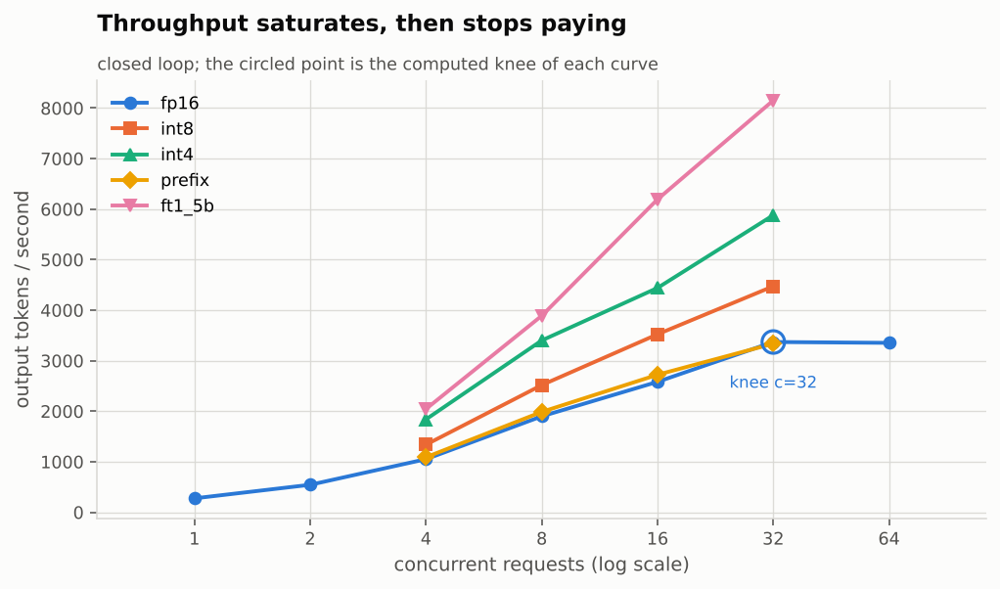
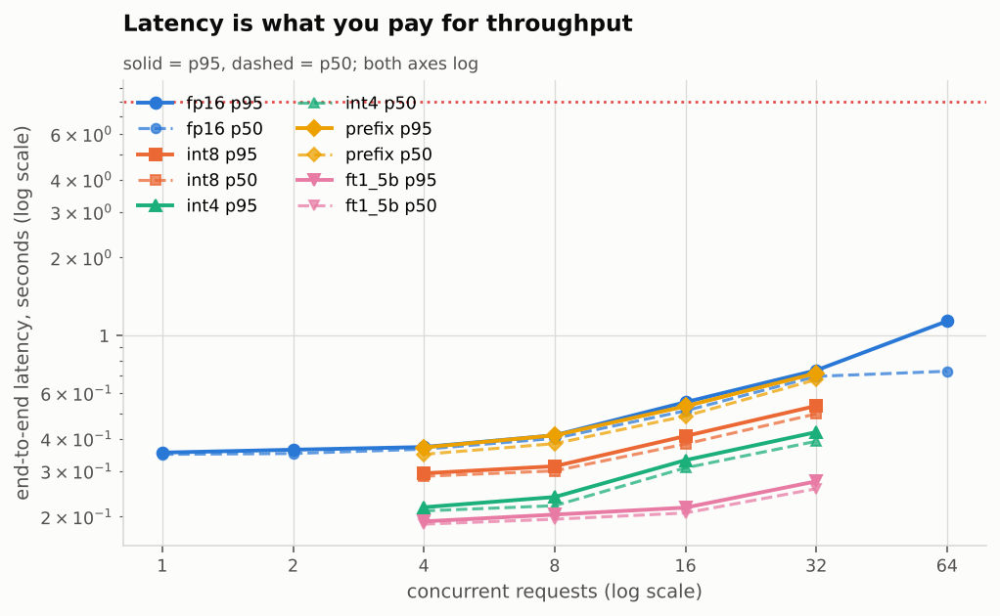
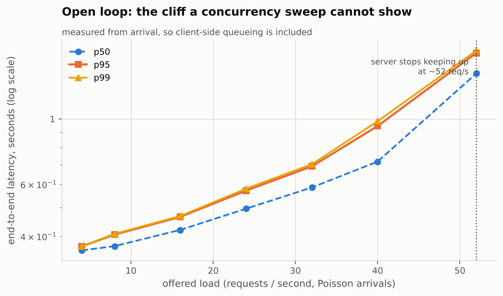
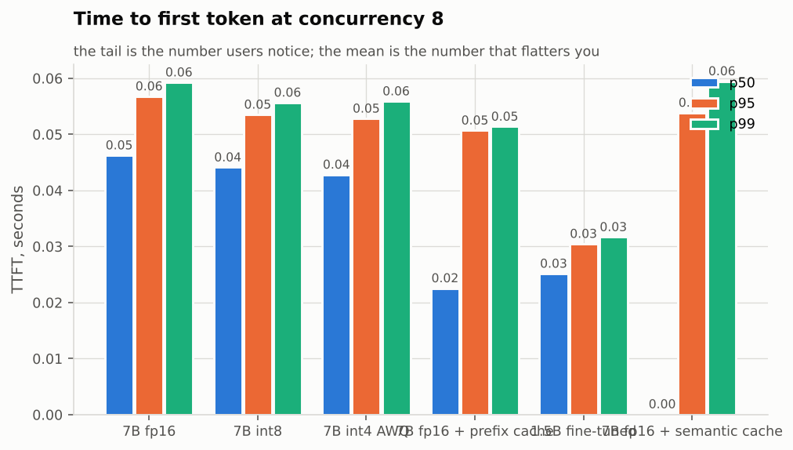
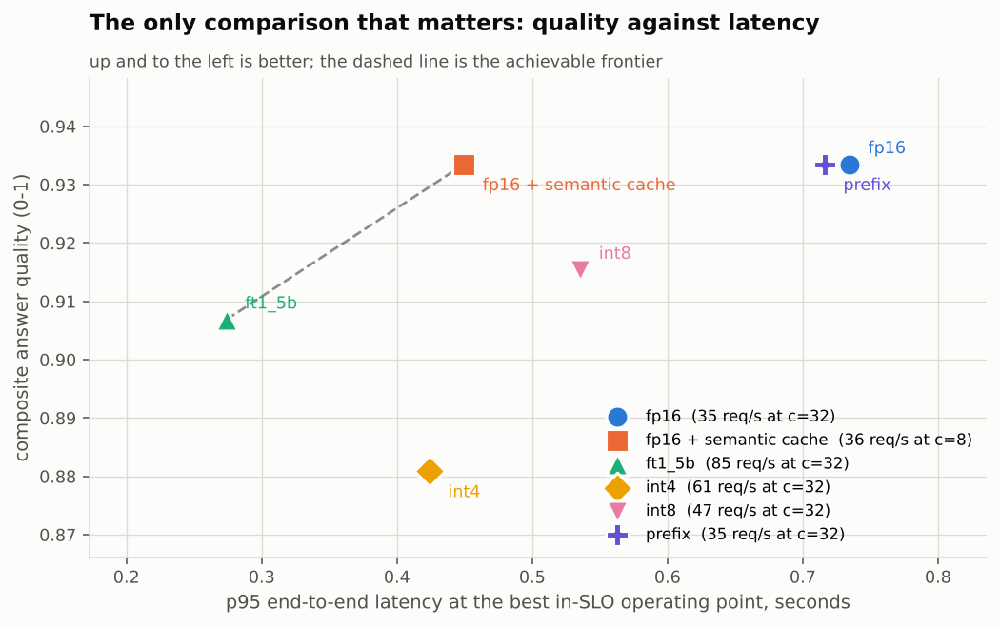
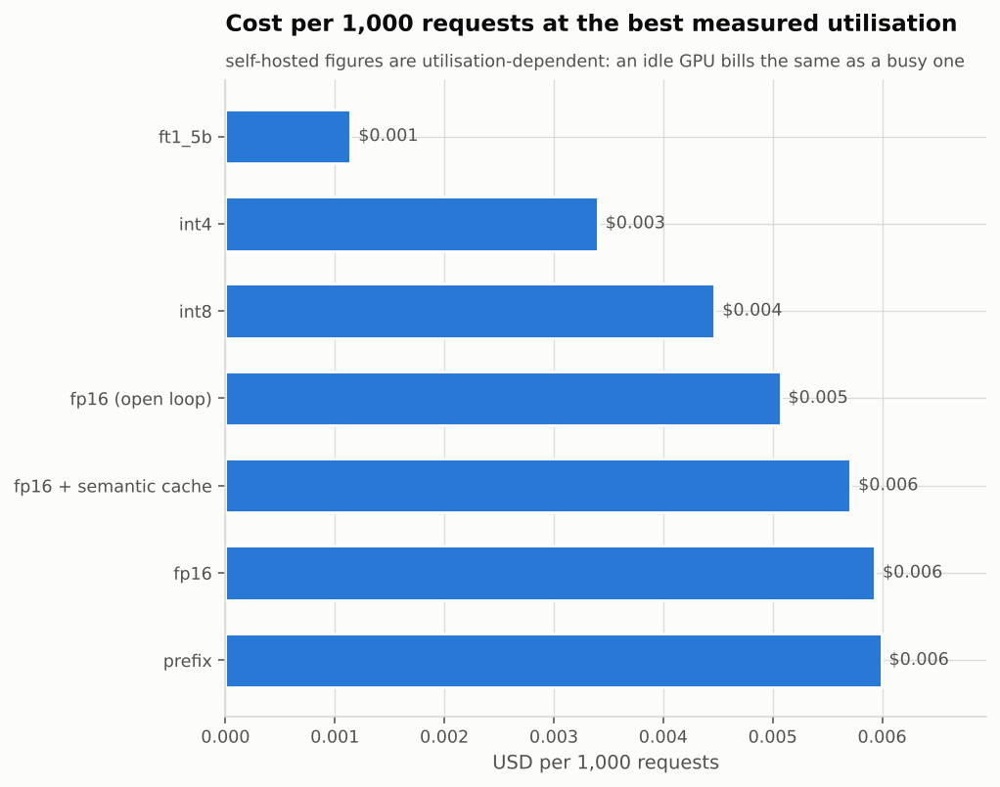
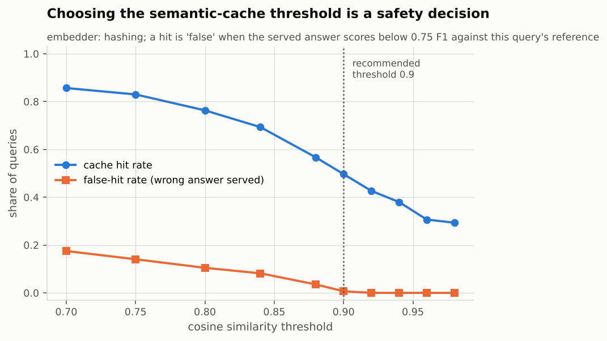

# Vantage report: demo

End-to-end demonstration against the simulated backend. Measures a concurrency sweep, three quantisation profiles, a fine-tuned small model and a semantic cache, scores every distinct model configuration for answer quality, and computes the self-host vs API break-even point.

> **Simulated backend.** At least one configuration in this run was the built-in
> simulator, not real hardware. The shapes are right and the pipeline is real;
> the absolute numbers are a model. Do not quote them as measurements.

- Run: `2026-10-10T14:20:33+00:00` UTC
- Commit: `not a git checkout`
- Host: Linux-6.18.44-fc-v114-x86_64-with-glibc2.39, Python 3.13.16
- GPUs: none detected
- Workload: `data/workload.sample.jsonl` -- 60 items, median prompt ~450 tokens
- SLO: {"ttft_p95_s": 1.0, "total_p95_s": 8.0, "max_error_rate": 0.01}

## Findings

- **fp16** saturates at about 3,370 output tokens/s. The knee of the curve is at concurrency 32 (3,370 tok/s, p95 0.73s): past that point throughput rises -1% more while p95 latency rises 55%.
- **int8** saturates at about 4,474 output tokens/s. The knee of the curve is at concurrency 16 (3,523 tok/s, p95 0.41s): past that point throughput rises 27% more while p95 latency rises 31%.
- **int4** saturates at about 5,880 output tokens/s. The knee of the curve is at concurrency 8 (3,401 tok/s, p95 0.24s): past that point throughput rises 73% more while p95 latency rises 78%.
- **prefix** saturates at about 3,337 output tokens/s. The knee of the curve is at concurrency 16 (2,722 tok/s, p95 0.53s): past that point throughput rises 23% more while p95 latency rises 34%.
- **ft1_5b** saturates at about 8,152 output tokens/s. The knee of the curve is at concurrency 16 (6,194 tok/s, p95 0.22s): past that point throughput rises 32% more while p95 latency rises 26%.
- The highest load served inside the SLO was **84.91 req/s** (1.5B fine-tuned, concurrency 32), with 100% of requests meeting it.
- Cheapest configuration measured: **1.5B fine-tuned** at $0.001 per 1,000 requests, 63.3x cheaper than 7B fp16.
- **Break-even:** self-hosting beats the API above **1.65 req/s** sustained (142,423 requests/day).
- **Quality gate failed for: int4, ft1_5b.** Faster, but measurably worse on the held-out set -- the speed-up is not free and the report does not pretend it is.
- Quality gate passed for: int8, prefix, fp16 (open loop), fp16 + semantic cache (no statistically significant regression against the baseline on paired bootstrap).
- **Semantic cache:** at threshold 0.9 the cache serves 50% of queries with a false-hit rate of 0.7% -- 149 model calls avoided out of 300.

## Self-host vs API

API costs $0.00013/request at 459 in / 96 out tokens. A $0.75/hour GPU costs $0.00021/second regardless of load, so it pays for itself above 1.65 req/s sustained (~142,423 requests/day) -- provided the GPU can actually serve that rate within SLO.

## Results

| config | mode | load | n | err | TTFT p50 | TTFT p95 | E2E p95 | total p95 | tok/s | req/s | goodput | $/1k | quality |
|---|---|---|---|---|---|---|---|---|---|---|---|---|---|
| 7B fp16 | closed | c=1 | 40 | 0.0% | 0.032 | 0.038 | 0.354 | 0.354 | 276 | 2.88 | 100% | 0.072 | 0.934 |
| 7B fp16 | closed | c=2 | 40 | 0.0% | 0.034 | 0.041 | 0.363 | 0.363 | 545 | 5.67 | 100% | 0.037 | 0.934 |
| 7B fp16 | closed | c=4 | 40 | 0.0% | 0.039 | 0.046 | 0.371 | 0.371 | 1,052 | 10.95 | 100% | 0.019 | 0.934 |
| 7B fp16 | closed | c=8 | 40 | 0.0% | 0.046 | 0.057 | 0.412 | 0.412 | 1,900 | 19.79 | 100% | 0.011 | 0.934 |
| 7B fp16 | closed | c=16 | 40 | 0.0% | 0.062 | 0.076 | 0.553 | 0.553 | 2,582 | 26.90 | 100% | 0.008 | 0.934 |
| 7B fp16 | closed | c=32 | 40 | 0.0% | 0.075 | 0.108 | 0.735 | 0.735 | 3,370 | 35.11 | 100% | 0.006 | 0.934 |
| 7B fp16 | closed | c=64 | 40 | 0.0% | 0.075 | 0.795 | 1.137 | 1.137 | 3,353 | 34.93 | 100% | 0.006 | 0.934 |
| 7B int8 | closed | c=4 | 40 | 0.0% | 0.037 | 0.043 | 0.294 | 0.294 | 1,339 | 13.94 | 100% | 0.015 | 0.915 |
| 7B int8 | closed | c=8 | 40 | 0.0% | 0.044 | 0.054 | 0.313 | 0.313 | 2,518 | 26.23 | 100% | 0.008 | 0.915 |
| 7B int8 | closed | c=16 | 40 | 0.0% | 0.058 | 0.072 | 0.410 | 0.410 | 3,523 | 36.70 | 100% | 0.006 | 0.915 |
| 7B int8 | closed | c=32 | 40 | 0.0% | 0.070 | 0.100 | 0.536 | 0.536 | 4,474 | 46.60 | 100% | 0.004 | 0.915 |
| 7B int4 AWQ | closed | c=4 | 40 | 0.0% | 0.036 | 0.043 | 0.218 | 0.218 | 1,839 | 19.16 | 100% | 0.011 | 0.881 |
| 7B int4 AWQ | closed | c=8 | 40 | 0.0% | 0.043 | 0.053 | 0.238 | 0.238 | 3,401 | 35.43 | 100% | 0.006 | 0.881 |
| 7B int4 AWQ | closed | c=16 | 40 | 0.0% | 0.058 | 0.072 | 0.331 | 0.331 | 4,441 | 46.26 | 100% | 0.005 | 0.881 |
| 7B int4 AWQ | closed | c=32 | 40 | 0.0% | 0.068 | 0.099 | 0.424 | 0.424 | 5,880 | 61.25 | 100% | 0.003 | 0.881 |
| 7B fp16 + prefix cache | closed | c=4 | 40 | 0.0% | 0.020 | 0.042 | 0.370 | 0.370 | 1,090 | 11.35 | 100% | 0.018 | 0.934 |
| 7B fp16 + prefix cache | closed | c=8 | 40 | 0.0% | 0.023 | 0.051 | 0.412 | 0.412 | 1,987 | 20.70 | 100% | 0.010 | 0.934 |
| 7B fp16 + prefix cache | closed | c=16 | 40 | 0.0% | 0.026 | 0.069 | 0.534 | 0.534 | 2,722 | 28.36 | 100% | 0.007 | 0.934 |
| 7B fp16 + prefix cache | closed | c=32 | 40 | 0.0% | 0.034 | 0.090 | 0.716 | 0.716 | 3,337 | 34.76 | 100% | 0.006 | 0.934 |
| 1.5B fine-tuned | closed | c=4 | 40 | 0.0% | 0.022 | 0.025 | 0.192 | 0.192 | 2,045 | 21.30 | 100% | 0.005 | 0.907 |
| 1.5B fine-tuned | closed | c=8 | 40 | 0.0% | 0.025 | 0.030 | 0.204 | 0.204 | 3,890 | 40.52 | 100% | 0.002 | 0.907 |
| 1.5B fine-tuned | closed | c=16 | 40 | 0.0% | 0.033 | 0.039 | 0.217 | 0.217 | 6,194 | 64.52 | 100% | 0.002 | 0.907 |
| 1.5B fine-tuned | closed | c=32 | 40 | 0.0% | 0.038 | 0.054 | 0.274 | 0.274 | 8,152 | 84.91 | 100% | 0.001 | 0.907 |
| 7B fp16, Poisson arrivals | open | 4 qps | 27 | 0.0% | 0.038 | 0.042 | 0.369 | 0.370 | 503 | 5.24 | 100% | 0.040 | 0.934 |
| 7B fp16, Poisson arrivals | open | 8 qps | 50 | 0.0% | 0.041 | 0.050 | 0.405 | 0.405 | 966 | 10.06 | 100% | 0.021 | 0.934 |
| 7B fp16, Poisson arrivals | open | 16 qps | 92 | 0.0% | 0.049 | 0.064 | 0.465 | 0.466 | 1,646 | 17.14 | 100% | 0.012 | 0.934 |
| 7B fp16, Poisson arrivals | open | 24 qps | 143 | 0.0% | 0.060 | 0.081 | 0.570 | 0.572 | 2,516 | 26.21 | 100% | 0.008 | 0.934 |
| 7B fp16, Poisson arrivals | open | 32 qps | 178 | 0.0% | 0.078 | 0.104 | 0.691 | 0.691 | 3,166 | 32.98 | 100% | 0.006 | 0.934 |
| 7B fp16, Poisson arrivals | open | 40 qps | 210 | 0.0% | 0.101 | 0.302 | 0.945 | 0.946 | 3,724 | 38.79 | 100% | 0.005 | 0.934 |
| 7B fp16, Poisson arrivals | open | 52 qps | 273 | 0.0% | 0.789 | 1.118 | 1.674 | 1.674 | 3,943 | 41.08 | 89% | 0.005 | 0.934 |
| 7B fp16 + semantic cache | closed | c=8 | 120 | 0.0% | 0.000 | 0.054 | 0.450 | 0.450 | 3,501 | 36.47 | 100% | 0.006 | 0.934 |

`total p95` is measured from request arrival, so it includes queueing; `E2E p95` starts at dispatch. In closed-loop runs the two are the same by construction.

## Charts

### Throughput vs concurrency



### Latency vs concurrency



### Latency vs offered load (open loop)



### TTFT percentiles



### Quality vs latency



### Cost per 1,000 requests



### Semantic cache threshold sweep



## Answer quality

| config | n | composite | token F1 | citation grounding | number agreement |
|---|---|---|---|---|---|
| fp16 | 30 | 0.934 | 0.904 | 1.000 | 1.000 |
| int8 | 30 | 0.915 | 0.905 | 0.933 | 1.000 |
| int4 | 30 | 0.881 | 0.900 | 0.833 | 0.983 |
| prefix | 30 | 0.934 | 0.904 | 1.000 | 1.000 |
| ft1_5b | 30 | 0.907 | 0.913 | 0.900 | 0.983 |
| fp16 (open loop) | 30 | 0.934 | 0.904 | 1.000 | 1.000 |
| fp16 + semantic cache | 30 | 0.934 | 0.904 | 1.000 | 1.000 |

Composite = 0.45 x token F1 + 0.25 x citation grounding + 0.25 x number agreement + 0.05 x exact match. Weights are a judgement call and are stated here so a reader can re-weight them.

### Quality gate

| candidate | baseline | delta | 95% CI | significant | verdict |
|---|---|---|---|---|---|
| int8 | fp16 | -0.018 | -0.047 to +0.000 | no | PASS |
| int4 | fp16 | -0.053 | -0.096 to -0.015 | yes | FAIL |
| prefix | fp16 | +0.000 | +0.000 to +0.000 | no | PASS |
| ft1_5b | fp16 | -0.027 | -0.056 to -0.003 | yes | FAIL |
| fp16 (open loop) | fp16 | +0.000 | +0.000 to +0.000 | no | PASS |
| fp16 + semantic cache | fp16 | +0.000 | +0.000 to +0.000 | no | PASS |

Deltas are paired bootstrap over per-item composite scores (2,000 resamples). A difference whose interval spans zero is not treated as a difference.

## Semantic cache

| threshold | hit rate | exact | semantic | false-hit rate | mean served quality |
|---|---|---|---|---|---|
| 0.70 | 85.7% | 6.7% | 79.0% | 17.5% | 0.912 |
| 0.75 | 83.0% | 6.7% | 76.3% | 14.1% | 0.930 |
| 0.80 | 76.3% | 8.7% | 67.7% | 10.5% | 0.950 |
| 0.84 | 69.3% | 11.7% | 57.7% | 8.2% | 0.960 |
| 0.88 | 56.7% | 19.3% | 37.3% | 3.5% | 0.977 |
| 0.90 | 49.7% | 20.0% | 29.7% | 0.7% | 0.986 |
| 0.92 | 42.7% | 21.0% | 21.7% | 0.0% | 0.991 |
| 0.94 | 38.0% | 22.3% | 15.7% | 0.0% | 0.992 |
| 0.96 | 30.7% | 24.7% | 6.0% | 0.0% | 0.992 |
| 0.98 | 29.3% | 25.0% | 4.3% | 0.0% | 0.992 |

**Recommendation:** highest hit rate (49.7%) among thresholds whose false-hit rate stays at or below 2.0%; at this setting 149 of 300 model calls are avoided

### What this run does not establish

- **Numbers are specific to this hardware, this model and this workload.** A
  throughput figure without the GPU, the model, the quantisation, the prompt
  length distribution and the output length distribution beside it is not a
  result. All of those are recorded in `manifest.json`.
- **Prompt and output lengths drive everything.** This workload is RAG-shaped:
  long prompts, short answers, so prefill dominates. A chat workload with short
  prompts and long answers inverts that and will produce different conclusions
  from the same server.
- **Short runs have fat tails.** A p99 computed over a few hundred requests is
  an estimate with real uncertainty. Bootstrap intervals are given for the means;
  treat single-run p99 differences below about 20% as noise unless the run is long.
- **Cost figures are arithmetic on list prices, not invoices.** They exclude
  engineering time, idle capacity, redundancy, egress and the fact that you must
  provision for peak while paying for mean.
- **The quality score is a proxy.** Token F1, citation grounding and number
  agreement catch the failures that matter most in a cited-answer RAG system, but
  they are not a human reading the answers. A config that passes the gate has not
  been proven good -- it has been shown not to have regressed on these measures.
- **One client, one network path.** Client-side CPU, Python async scheduling and
  network latency are inside every measurement. For absolute numbers the load
  generator should run on a separate machine close to the server.


### Reproducing this

```bash
vantage sweep -c configs/sweeps/demo.yaml
```

Raw per-request records are in `raw.jsonl`; every chart and every number above is derived from that file plus `summaries.json`.
