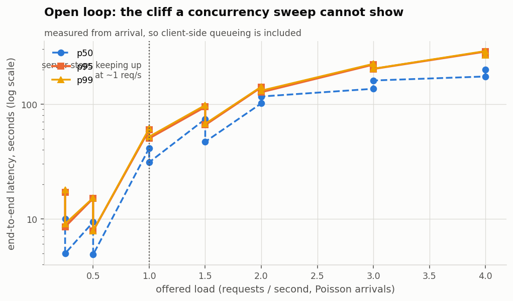
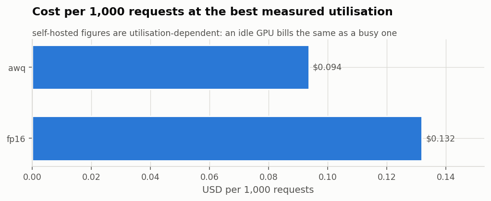

# Vantage report: kaggle-t4-offered-load

Open-loop (Poisson) offered load, Qwen3-4B fp16 vs AWQ int4 on vLLM, one Kaggle T4 each, Vectora workload.

- Run: `2026-10-27T10:03:38+00:00` UTC
- Commit: `2cb7094` (working tree dirty)
- Host: Linux-6.18.55+-x86_64-with-glibc2.39, Python 3.13.15
- GPUs: Tesla T4, 15360 MiB, 580.178.04, Tesla T4, 15360 MiB, 580.178.04
- Workload: `data/workload.vectora.jsonl` -- 365 items, median prompt ~663 tokens
- SLO: {"ttft_p95_s": 2.0, "total_p95_s": 15.0, "max_error_rate": 0.01}

## Findings

- Cheapest configuration measured: **Qwen3-4B AWQ int4 (T4), Poisson arrivals** at $0.094 per 1,000 requests, 3.4x cheaper than Qwen3-4B fp16 (T4), Poisson arrivals.
- **Break-even:** self-hosting beats the API above **0.40 req/s** sustained (34,535 requests/day).

## Self-host vs API

API costs $0.00024/request at 1033 in / 147 out tokens. A $0.35/hour GPU costs $0.00010/second regardless of load, so it pays for itself above 0.40 req/s sustained (~34,535 requests/day) -- provided the GPU can actually serve that rate within SLO.

## Results

| config | mode | load | n | err | TTFT p50 | TTFT p95 | E2E p95 | total p95 | tok/s | req/s | goodput | $/1k | quality |
|---|---|---|---|---|---|---|---|---|---|---|---|---|---|
| Qwen3-4B fp16 (T4), Poisson arrivals | open | 0.25 qps | 30 | 0.0% | 0.725 | 1.432 | 17.026 | 17.027 | 44 | 0.31 | 80% | 0.315 | -- |
| Qwen3-4B fp16 (T4), Poisson arrivals | open | 0.5 qps | 30 | 0.0% | 0.184 | 0.248 | 15.050 | 15.051 | 80 | 0.56 | 93% | 0.175 | -- |
| Qwen3-4B fp16 (T4), Poisson arrivals | open | 1 qps | 71 | 0.0% | 1.488 | 17.488 | 59.676 | 59.677 | 107 | 0.74 | 18% | 0.132 | -- |
| Qwen3-4B fp16 (T4), Poisson arrivals | open | 1.5 qps | 99 | 0.0% | 31.362 | 60.869 | 94.408 | 94.409 | 101 | 0.71 | 1% | 0.137 | -- |
| Qwen3-4B fp16 (T4), Poisson arrivals | open | 2 qps | 143 | 0.0% | 49.922 | 115.493 | 140.071 | 140.072 | 102 | 0.71 | 0% | 0.136 | -- |
| Qwen3-4B fp16 (T4), Poisson arrivals | open | 3 qps | 195 | 0.0% | 90.098 | 193.453 | 220.926 | 220.927 | 100 | 0.70 | 0% | 0.140 | -- |
| Qwen3-4B fp16 (T4), Poisson arrivals | open | 4 qps | 247 | 0.0% | 126.116 | 253.110 | 286.778 | 286.779 | 102 | 0.71 | 0% | 0.137 | -- |
| Qwen3-4B AWQ int4 (T4), Poisson arrivals | open | 0.25 qps | 30 | 0.0% | 0.625 | 1.195 | 8.510 | 8.511 | 50 | 0.33 | 100% | 0.299 | -- |
| Qwen3-4B AWQ int4 (T4), Poisson arrivals | open | 0.5 qps | 30 | 0.0% | 0.097 | 0.137 | 7.835 | 7.836 | 94 | 0.62 | 100% | 0.157 | -- |
| Qwen3-4B AWQ int4 (T4), Poisson arrivals | open | 1 qps | 71 | 0.0% | 1.019 | 3.111 | 50.266 | 50.267 | 134 | 0.86 | 30% | 0.113 | -- |
| Qwen3-4B AWQ int4 (T4), Poisson arrivals | open | 1.5 qps | 99 | 0.0% | 0.930 | 6.586 | 65.713 | 65.714 | 155 | 1.04 | 3% | 0.094 | -- |
| Qwen3-4B AWQ int4 (T4), Poisson arrivals | open | 2 qps | 143 | 0.0% | 13.266 | 83.365 | 126.946 | 126.947 | 122 | 0.81 | 1% | 0.120 | -- |
| Qwen3-4B AWQ int4 (T4), Poisson arrivals | open | 3 qps | 195 | 0.0% | 76.434 | 159.505 | 202.341 | 202.342 | 116 | 0.77 | 0% | 0.126 | -- |
| Qwen3-4B AWQ int4 (T4), Poisson arrivals | open | 4 qps | 247 | 0.0% | 107.507 | 216.571 | 265.950 | 265.951 | 117 | 0.77 | 0% | 0.126 | -- |

`total p95` is measured from request arrival, so it includes queueing; `E2E p95` starts at dispatch. In closed-loop runs the two are the same by construction.

### Side by side

| load | fp16 | awq |
|---|---|---|
| 0.25 qps | 1.43 / 67 / 80% | 1.20 / 27 / 100% |
| 0.5 qps | 0.25 / 71 / 93% | 0.14 / 32 / 100% |
| 1 qps | 17.49 / 249 / 18% | 3.11 / 195 / 30% |
| 1.5 qps | 60.87 / 321 / 1% | 6.59 / 319 / 3% |
| 2 qps | 115.49 / 336 / 0% | 83.37 / 532 / 1% |
| 3 qps | 193.45 / 345 / 0% | 159.51 / 592 / 0% |
| 4 qps | 253.11 / 343 / 0% | 216.57 / 597 / 0% |

Each cell: TTFT p95 (s) / inter-token latency p50 (ms) / goodput.

## What the server saw

| config | load | KV mean | KV max | running max | waiting mean | waiting max | preempted | prefix hit | queue s (server) | TTFT s (server) | TTFT s (client) |
|---|---|---|---|---|---|---|---|---|---|---|---|
| Qwen3-4B fp16 (T4), Poisson arrivals | 0.25 qps | 8% | 22% | 8 | 0.0 | 0 | 0 | 45% | 0.000 | 0.703 | 0.706 |
| Qwen3-4B fp16 (T4), Poisson arrivals | 0.5 qps | 10% | 30% | 11 | 0.0 | 0 | 0 | 99% | 0.000 | 0.161 | 0.185 |
| Qwen3-4B fp16 (T4), Poisson arrivals | 1 qps | 46% | 100% | 36 | 1.7 | 13 | 7 | 63% | 2.875 | 4.109 | 4.571 |
| Qwen3-4B fp16 (T4), Poisson arrivals | 1.5 qps | 62% | 100% | 39 | 12.7 | 45 | 10 | 35% | 22.865 | 24.967 | 26.935 |
| Qwen3-4B fp16 (T4), Poisson arrivals | 2 qps | 71% | 100% | 39 | 28.4 | 89 | 13 | 33% | 47.797 | 49.888 | 52.647 |
| Qwen3-4B fp16 (T4), Poisson arrivals | 3 qps | 78% | 100% | 39 | 52.2 | 141 | 30 | 32% | 85.886 | 88.179 | 91.777 |
| Qwen3-4B fp16 (T4), Poisson arrivals | 4 qps | 81% | 100% | 39 | 77.1 | 193 | 40 | 32% | 121.854 | 124.062 | 128.067 |
| Qwen3-4B AWQ int4 (T4), Poisson arrivals | 0.25 qps | 2% | 8% | 6 | 0.0 | 0 | 0 | 45% | 0.000 | 0.584 | 0.568 |
| Qwen3-4B AWQ int4 (T4), Poisson arrivals | 0.5 qps | 4% | 10% | 7 | 0.0 | 0 | 0 | 99% | 0.000 | 0.083 | 0.097 |
| Qwen3-4B AWQ int4 (T4), Poisson arrivals | 1 qps | 26% | 63% | 46 | 0.0 | 1 | 0 | 63% | 0.002 | 1.050 | 1.171 |
| Qwen3-4B AWQ int4 (T4), Poisson arrivals | 1.5 qps | 49% | 100% | 76 | 0.2 | 3 | 3 | 66% | 0.111 | 1.780 | 1.901 |
| Qwen3-4B AWQ int4 (T4), Poisson arrivals | 2 qps | 68% | 100% | 80 | 21.2 | 67 | 12 | 37% | 28.401 | 31.989 | 33.755 |
| Qwen3-4B AWQ int4 (T4), Poisson arrivals | 3 qps | 77% | 100% | 80 | 46.7 | 119 | 21 | 32% | 64.832 | 68.425 | 71.219 |
| Qwen3-4B AWQ int4 (T4), Poisson arrivals | 4 qps | 81% | 100% | 80 | 72.6 | 172 | 31 | 32% | 99.347 | 102.964 | 106.293 |

Scraped from vLLM's `/metrics` every second during each run. **KV** is the share of the KV cache in use: when it nears 100%, new requests wait (**waiting**) and running ones can be **preempted** (evicted and recomputed later), which is where tail latency comes from. **prefix hit** is the share of prompt tokens served from cached prefixes (the shared system prompt). Server TTFT starts when vLLM receives the request; the client's also includes the client and the HTTP hop, so the gap between them is overhead outside the engine.

## Charts

### Latency vs offered load (open loop)



### Cost per 1,000 requests



### What this run does not establish

- **Numbers are specific to this hardware, this model and this workload.** A
  throughput figure without the GPU, the model, the quantisation, the prompt
  length distribution and the output length distribution beside it is not a
  result. All of those are recorded in `manifest.json`.
- **Prompt and output lengths drive everything.** This workload is RAG-shaped:
  long prompts, short answers, so prefill dominates. A chat workload with short
  prompts and long answers inverts that and will produce different conclusions
  from the same server.
- **Short runs have fat tails.** A p99 computed over a few hundred requests is
  an estimate with real uncertainty. Bootstrap intervals are given for the means;
  treat single-run p99 differences below about 20% as noise unless the run is long.
- **Cost figures are arithmetic on list prices, not invoices.** They exclude
  engineering time, idle capacity, redundancy, egress and the fact that you must
  provision for peak while paying for mean.
- **The quality score is a proxy.** Token F1, citation grounding and number
  agreement catch the failures that matter most in a cited-answer RAG system, but
  they are not a human reading the answers. A config that passes the gate has not
  been proven good -- it has been shown not to have regressed on these measures.
- **One client, one network path.** Client-side CPU, Python async scheduling and
  network latency are inside every measurement. For absolute numbers the load
  generator should run on a separate machine close to the server.


### Reproducing this

```bash
vantage sweep -c /kaggle/working/vantage_repo/configs/sweeps/kaggle-t4-offered-load.yaml
```

Raw per-request records are in `raw.jsonl`; every chart and every number above is derived from that file plus `summaries.json`.
