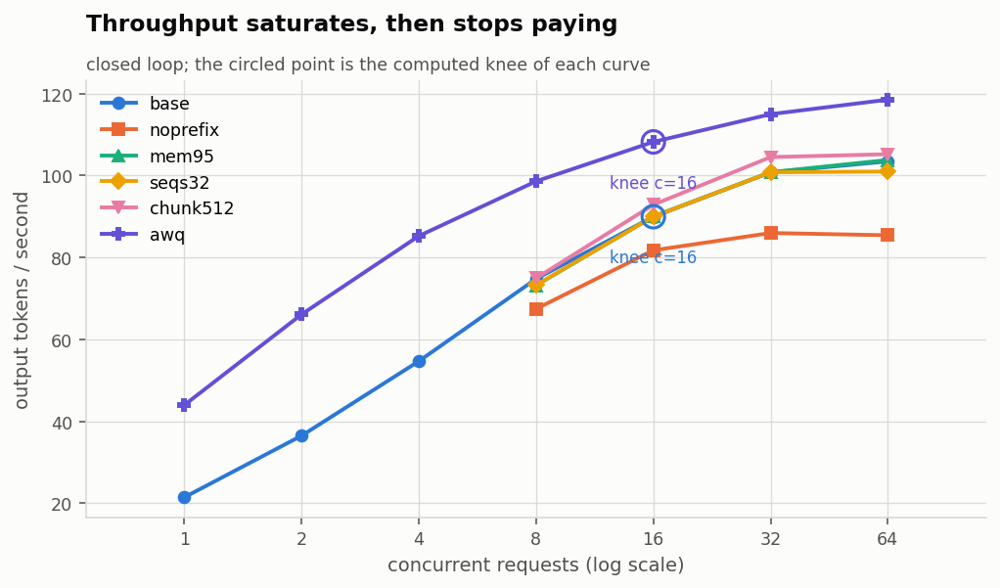
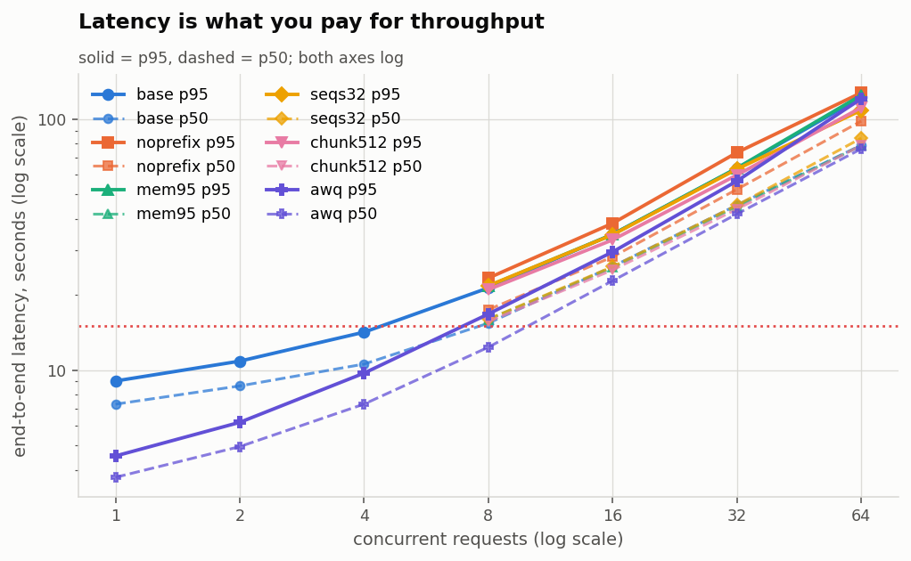
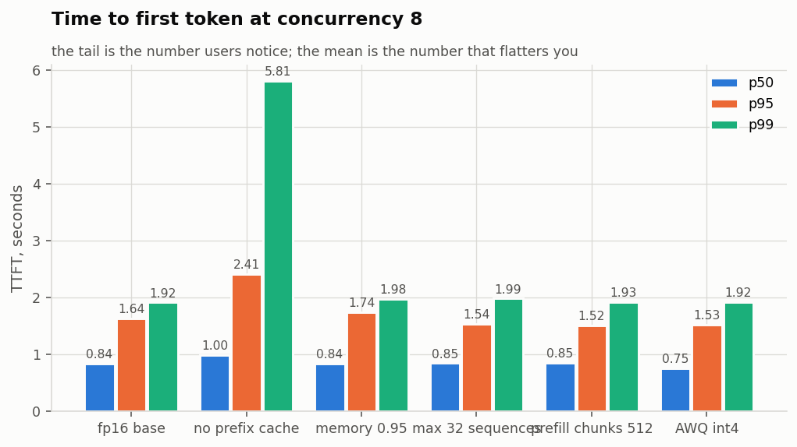
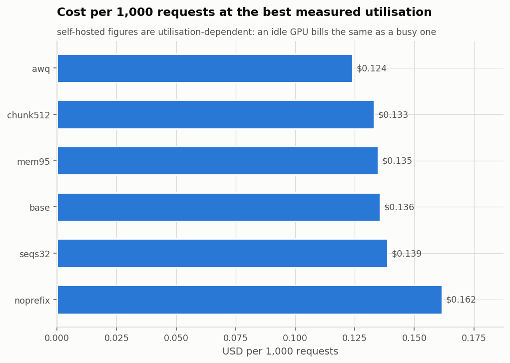

# Vantage report: kaggle-t4-tune

vLLM settings one at a time, Qwen3-4B fp16 on a Kaggle T4, Vectora workload, with server metrics.

- Run: `2026-10-27T11:34:44+00:00` UTC
- Commit: `e228ab0`
- Host: Linux-6.18.55+-x86_64-with-glibc2.39, Python 3.13.15
- GPUs: Tesla T4, 15360 MiB, 580.178.04, Tesla T4, 15360 MiB, 580.178.04
- Workload: `data/workload.vectora.jsonl` -- 365 items, median prompt ~663 tokens
- SLO: {"ttft_p95_s": 2.0, "total_p95_s": 15.0, "max_error_rate": 0.01}

## Findings

- **base** saturates at about 103 output tokens/s. The knee of the curve is at concurrency 16 (90 tok/s, p95 34.73s): past that point throughput rises 15% more while p95 latency rises 252%.
- **noprefix** saturates at about 86 output tokens/s. The knee of the curve is at concurrency 16 (82 tok/s, p95 38.42s): past that point throughput rises 4% more while p95 latency rises 231%.
- **mem95** saturates at about 104 output tokens/s. The knee of the curve is at concurrency 32 (101 tok/s, p95 63.75s): past that point throughput rises 3% more while p95 latency rises 95%.
- **seqs32** saturates at about 101 output tokens/s. The knee of the curve is at concurrency 32 (101 tok/s, p95 63.16s): past that point throughput rises 0% more while p95 latency rises 72%.
- **chunk512** saturates at about 105 output tokens/s. The knee of the curve is at concurrency 32 (105 tok/s, p95 59.82s): past that point throughput rises 1% more while p95 latency rises 86%.
- **awq** saturates at about 119 output tokens/s. The knee of the curve is at concurrency 16 (108 tok/s, p95 29.55s): past that point throughput rises 10% more while p95 latency rises 307%.
- The highest load served inside the SLO was **0.57 req/s** (AWQ int4, concurrency 4), with 100% of requests meeting it.
- Cheapest configuration measured: **AWQ int4** at $0.124 per 1,000 requests, 5.4x cheaper than fp16 base.
- **Break-even:** self-hosting beats the API above **0.40 req/s** sustained (34,560 requests/day).

## Self-host vs API

API costs $0.00024/request at 1038 in / 146 out tokens. A $0.35/hour GPU costs $0.00010/second regardless of load, so it pays for itself above 0.40 req/s sustained (~34,560 requests/day) -- provided the GPU can actually serve that rate within SLO.

## Results

| config | mode | load | n | err | TTFT p50 | TTFT p95 | E2E p95 | total p95 | tok/s | req/s | goodput | $/1k | quality |
|---|---|---|---|---|---|---|---|---|---|---|---|---|---|
| fp16 base | closed | c=1 | 48 | 0.0% | 0.660 | 0.874 | 9.046 | 9.046 | 21 | 0.14 | 100% | 0.675 | -- |
| fp16 base | closed | c=2 | 48 | 0.0% | 0.711 | 0.911 | 10.852 | 10.852 | 36 | 0.25 | 100% | 0.396 | -- |
| fp16 base | closed | c=4 | 96 | 0.0% | 0.743 | 1.208 | 14.154 | 14.154 | 55 | 0.38 | 99% | 0.253 | -- |
| fp16 base | closed | c=8 | 96 | 0.0% | 0.841 | 1.638 | 21.244 | 21.244 | 75 | 0.52 | 47% | 0.186 | -- |
| fp16 base | closed | c=16 | 160 | 0.0% | 0.946 | 3.633 | 34.730 | 34.730 | 90 | 0.63 | 6% | 0.156 | -- |
| fp16 base | closed | c=32 | 160 | 0.0% | 1.665 | 11.366 | 63.546 | 63.546 | 101 | 0.70 | 2% | 0.139 | -- |
| fp16 base | closed | c=64 | 160 | 0.0% | 29.391 | 61.744 | 122.130 | 122.130 | 103 | 0.72 | 0% | 0.136 | -- |
| no prefix cache | closed | c=8 | 160 | 0.0% | 0.995 | 2.410 | 23.250 | 23.250 | 67 | 0.47 | 31% | 0.207 | -- |
| no prefix cache | closed | c=16 | 160 | 0.0% | 1.176 | 6.803 | 38.419 | 38.419 | 82 | 0.57 | 4% | 0.171 | -- |
| no prefix cache | closed | c=32 | 160 | 0.0% | 5.059 | 18.995 | 73.495 | 73.495 | 86 | 0.60 | 0% | 0.162 | -- |
| no prefix cache | closed | c=64 | 160 | 0.0% | 54.842 | 78.540 | 127.216 | 127.216 | 85 | 0.59 | 0% | 0.163 | -- |
| memory 0.95 | closed | c=8 | 160 | 0.0% | 0.838 | 1.742 | 21.596 | 21.596 | 73 | 0.51 | 39% | 0.191 | -- |
| memory 0.95 | closed | c=16 | 160 | 0.0% | 0.950 | 3.638 | 34.701 | 34.701 | 90 | 0.63 | 7% | 0.155 | -- |
| memory 0.95 | closed | c=32 | 160 | 0.0% | 1.629 | 12.498 | 63.746 | 63.746 | 101 | 0.70 | 2% | 0.139 | -- |
| memory 0.95 | closed | c=64 | 160 | 0.0% | 21.625 | 58.704 | 124.334 | 124.334 | 104 | 0.72 | 0% | 0.135 | -- |
| max 32 sequences | closed | c=8 | 160 | 0.0% | 0.848 | 1.537 | 21.672 | 21.672 | 73 | 0.51 | 40% | 0.191 | -- |
| max 32 sequences | closed | c=16 | 160 | 0.0% | 0.948 | 3.598 | 34.586 | 34.586 | 90 | 0.62 | 6% | 0.156 | -- |
| max 32 sequences | closed | c=32 | 160 | 0.0% | 1.647 | 13.870 | 63.160 | 63.160 | 101 | 0.70 | 2% | 0.139 | -- |
| max 32 sequences | closed | c=64 | 160 | 0.0% | 44.373 | 63.237 | 108.361 | 108.361 | 101 | 0.70 | 0% | 0.139 | -- |
| prefill chunks 512 | closed | c=8 | 160 | 0.0% | 0.851 | 1.518 | 20.925 | 20.925 | 75 | 0.52 | 44% | 0.187 | -- |
| prefill chunks 512 | closed | c=16 | 160 | 0.0% | 1.059 | 2.864 | 33.004 | 33.004 | 93 | 0.64 | 9% | 0.151 | -- |
| prefill chunks 512 | closed | c=32 | 160 | 0.0% | 1.819 | 12.386 | 59.824 | 59.824 | 105 | 0.73 | 2% | 0.134 | -- |
| prefill chunks 512 | closed | c=64 | 160 | 0.0% | 36.159 | 63.282 | 111.037 | 111.037 | 105 | 0.73 | 1% | 0.133 | -- |
| AWQ int4 | closed | c=1 | 48 | 0.0% | 0.625 | 0.867 | 4.547 | 4.547 | 44 | 0.28 | 100% | 0.346 | -- |
| AWQ int4 | closed | c=2 | 48 | 0.0% | 0.646 | 0.881 | 6.191 | 6.191 | 66 | 0.42 | 100% | 0.231 | -- |
| AWQ int4 | closed | c=4 | 96 | 0.0% | 0.675 | 0.897 | 9.722 | 9.722 | 85 | 0.57 | 100% | 0.172 | -- |
| AWQ int4 | closed | c=8 | 160 | 0.0% | 0.754 | 1.525 | 16.718 | 16.718 | 99 | 0.66 | 76% | 0.148 | -- |
| AWQ int4 | closed | c=16 | 160 | 0.0% | 0.896 | 2.780 | 29.554 | 29.554 | 108 | 0.72 | 14% | 0.136 | -- |
| AWQ int4 | closed | c=32 | 160 | 0.0% | 1.622 | 11.202 | 56.636 | 56.636 | 115 | 0.76 | 1% | 0.129 | -- |
| AWQ int4 | closed | c=64 | 160 | 0.0% | 3.258 | 36.895 | 120.428 | 120.428 | 119 | 0.78 | 0% | 0.124 | -- |

`total p95` is measured from request arrival, so it includes queueing; `E2E p95` starts at dispatch. In closed-loop runs the two are the same by construction.

### Side by side

| load | base | noprefix | mem95 | seqs32 | chunk512 | awq |
|---|---|---|---|---|---|---|
| c=1 | 0.87 / 43 / 100% | -- | -- | -- | -- | 0.87 / 19 / 100% |
| c=2 | 0.91 / 51 / 100% | -- | -- | -- | -- | 0.88 / 26 / 100% |
| c=4 | 1.21 / 67 / 99% | -- | -- | -- | -- | 0.90 / 43 / 100% |
| c=8 | 1.64 / 101 / 47% | 2.41 / 110 / 31% | 1.74 / 101 / 39% | 1.54 / 101 / 40% | 1.52 / 99 / 44% | 1.53 / 76 / 76% |
| c=16 | 3.63 / 168 / 6% | 6.80 / 183 / 4% | 3.64 / 169 / 7% | 3.60 / 168 / 6% | 2.86 / 163 / 9% | 2.78 / 142 / 14% |
| c=32 | 11.37 / 301 / 2% | 18.99 / 331 / 0% | 12.50 / 302 / 2% | 13.87 / 303 / 2% | 12.39 / 287 / 2% | 11.20 / 270 / 1% |
| c=64 | 61.74 / 375 / 0% | 78.54 / 335 / 0% | 58.70 / 436 / 0% | 63.24 / 305 / 0% | 63.28 / 321 / 1% | 36.90 / 491 / 0% |

Each cell: TTFT p95 (s) / inter-token latency p50 (ms) / goodput.

## What the server saw

| config | load | KV mean | KV max | running max | waiting mean | waiting max | preempted | prefix hit | queue s (server) | TTFT s (server) | TTFT s (client) |
|---|---|---|---|---|---|---|---|---|---|---|---|
| fp16 base | c=1 | 3% | 5% | 1 | 0.0 | 0 | 0 | 39% | 0.000 | 0.642 | 0.609 |
| fp16 base | c=2 | 6% | 7% | 2 | 0.0 | 0 | 0 | 39% | 0.000 | 0.692 | 0.663 |
| fp16 base | c=4 | 10% | 12% | 4 | 0.0 | 0 | 0 | 35% | 0.000 | 0.806 | 0.754 |
| fp16 base | c=8 | 19% | 23% | 8 | 0.0 | 4 | 0 | 35% | 0.048 | 1.107 | 0.893 |
| fp16 base | c=16 | 36% | 44% | 16 | 0.1 | 4 | 0 | 32% | 0.039 | 1.470 | 1.368 |
| fp16 base | c=32 | 67% | 82% | 32 | 0.6 | 20 | 0 | 32% | 0.796 | 2.936 | 2.920 |
| fp16 base | c=64 | 83% | 100% | 45 | 17.2 | 46 | 19 | 32% | 25.169 | 28.032 | 29.298 |
| no prefix cache | c=8 | 25% | 31% | 8 | 0.1 | 5 | 0 | -- | 0.119 | 1.435 | 1.258 |
| no prefix cache | c=16 | 47% | 57% | 16 | 0.3 | 13 | 0 | -- | 0.394 | 2.078 | 1.986 |
| no prefix cache | c=32 | 85% | 100% | 32 | 2.2 | 26 | 15 | -- | 4.012 | 6.388 | 6.520 |
| no prefix cache | c=64 | 85% | 100% | 32 | 25.5 | 59 | 17 | -- | 44.573 | 47.031 | 49.218 |
| memory 0.95 | c=8 | 17% | 22% | 8 | 0.0 | 4 | 0 | 32% | 0.028 | 1.046 | 0.920 |
| memory 0.95 | c=16 | 31% | 38% | 16 | 0.1 | 4 | 0 | 32% | 0.039 | 1.429 | 1.325 |
| memory 0.95 | c=32 | 58% | 71% | 32 | 0.5 | 16 | 0 | 32% | 0.707 | 2.834 | 2.812 |
| memory 0.95 | c=64 | 82% | 100% | 52 | 13.0 | 46 | 16 | 32% | 18.756 | 21.883 | 22.848 |
| max 32 sequences | c=8 | 20% | 26% | 8 | 0.0 | 4 | 0 | 32% | 0.029 | 1.076 | 0.906 |
| max 32 sequences | c=16 | 37% | 45% | 16 | 0.1 | 4 | 0 | 32% | 0.049 | 1.499 | 1.399 |
| max 32 sequences | c=32 | 69% | 84% | 32 | 0.6 | 19 | 0 | 32% | 0.820 | 2.872 | 2.850 |
| max 32 sequences | c=64 | 69% | 85% | 32 | 23.0 | 46 | 0 | 32% | 34.734 | 37.011 | 38.725 |
| prefill chunks 512 | c=8 | 22% | 28% | 8 | 0.0 | 6 | 0 | 32% | 0.090 | 1.091 | 0.938 |
| prefill chunks 512 | c=16 | 41% | 49% | 16 | 0.1 | 6 | 0 | 32% | 0.206 | 1.425 | 1.349 |
| prefill chunks 512 | c=32 | 75% | 94% | 32 | 0.9 | 23 | 0 | 32% | 1.282 | 2.951 | 2.957 |
| prefill chunks 512 | c=64 | 83% | 100% | 38 | 21.5 | 53 | 15 | 32% | 30.568 | 32.361 | 33.870 |
| AWQ int4 | c=1 | 2% | 3% | 1 | 0.0 | 0 | 0 | 39% | 0.000 | 0.605 | 0.575 |
| AWQ int4 | c=2 | 3% | 4% | 2 | 0.0 | 0 | 0 | 39% | 0.000 | 0.629 | 0.598 |
| AWQ int4 | c=4 | 6% | 7% | 4 | 0.0 | 0 | 0 | 35% | 0.000 | 0.722 | 0.662 |
| AWQ int4 | c=8 | 11% | 14% | 8 | 0.0 | 4 | 0 | 32% | 0.030 | 0.971 | 0.835 |
| AWQ int4 | c=16 | 20% | 24% | 16 | 0.1 | 4 | 0 | 32% | 0.045 | 1.369 | 1.258 |
| AWQ int4 | c=32 | 38% | 48% | 32 | 0.6 | 17 | 0 | 32% | 0.724 | 2.725 | 2.693 |
| AWQ int4 | c=64 | 68% | 91% | 64 | 4.5 | 51 | 0 | 32% | 5.864 | 9.365 | 9.705 |

Scraped from vLLM's `/metrics` every second during each run. **KV** is the share of the KV cache in use: when it nears 100%, new requests wait (**waiting**) and running ones can be **preempted** (evicted and recomputed later), which is where tail latency comes from. **prefix hit** is the share of prompt tokens served from cached prefixes (the shared system prompt). Server TTFT starts when vLLM receives the request; the client's also includes the client and the HTTP hop, so the gap between them is overhead outside the engine.

## Charts

### Throughput vs concurrency



### Latency vs concurrency



### TTFT percentiles



### What the server saw


### Cost per 1,000 requests



### What this run does not establish

- **Numbers are specific to this hardware, this model and this workload.** A
  throughput figure without the GPU, the model, the quantisation, the prompt
  length distribution and the output length distribution beside it is not a
  result. All of those are recorded in `manifest.json`.
- **Prompt and output lengths drive everything.** This workload is RAG-shaped:
  long prompts, short answers, so prefill dominates. A chat workload with short
  prompts and long answers inverts that and will produce different conclusions
  from the same server.
- **Short runs have fat tails.** A p99 computed over a few hundred requests is
  an estimate with real uncertainty. Bootstrap intervals are given for the means;
  treat single-run p99 differences below about 20% as noise unless the run is long.
- **Cost figures are arithmetic on list prices, not invoices.** They exclude
  engineering time, idle capacity, redundancy, egress and the fact that you must
  provision for peak while paying for mean.
- **The quality score is a proxy.** Token F1, citation grounding and number
  agreement catch the failures that matter most in a cited-answer RAG system, but
  they are not a human reading the answers. A config that passes the gate has not
  been proven good -- it has been shown not to have regressed on these measures.
- **One client, one network path.** Client-side CPU, Python async scheduling and
  network latency are inside every measurement. For absolute numbers the load
  generator should run on a separate machine close to the server.


### Reproducing this

```bash
vantage sweep -c /kaggle/working/vantage_repo/configs/sweeps/kaggle-t4-tune.yaml
```

Raw per-request records are in `raw.jsonl`; every chart and every number above is derived from that file plus `summaries.json`.
